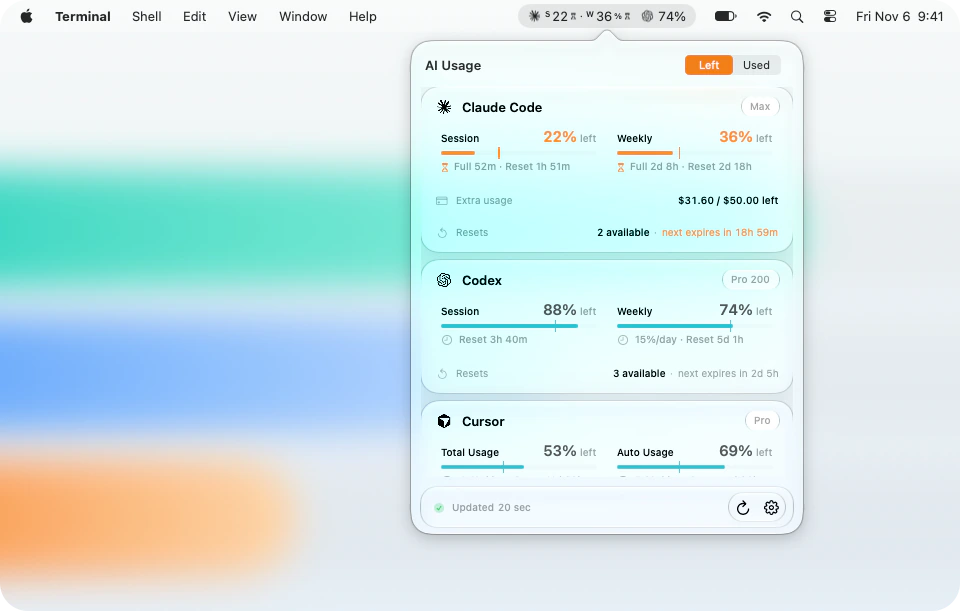
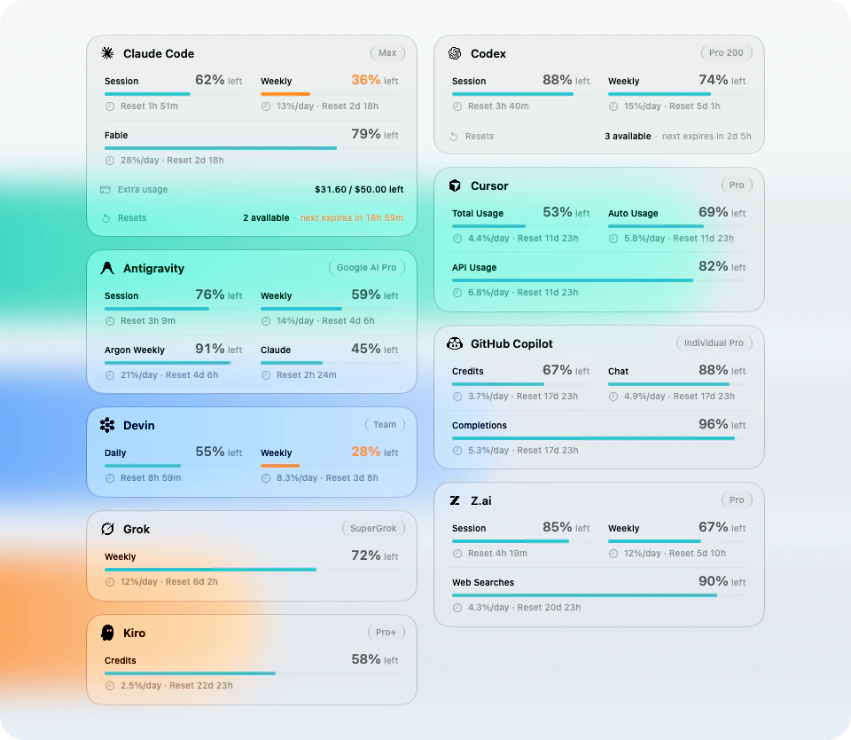
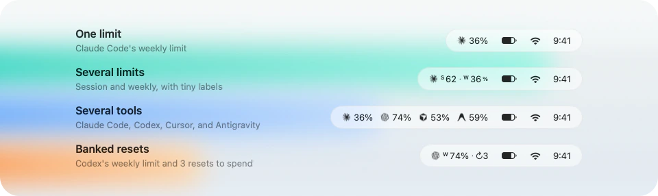
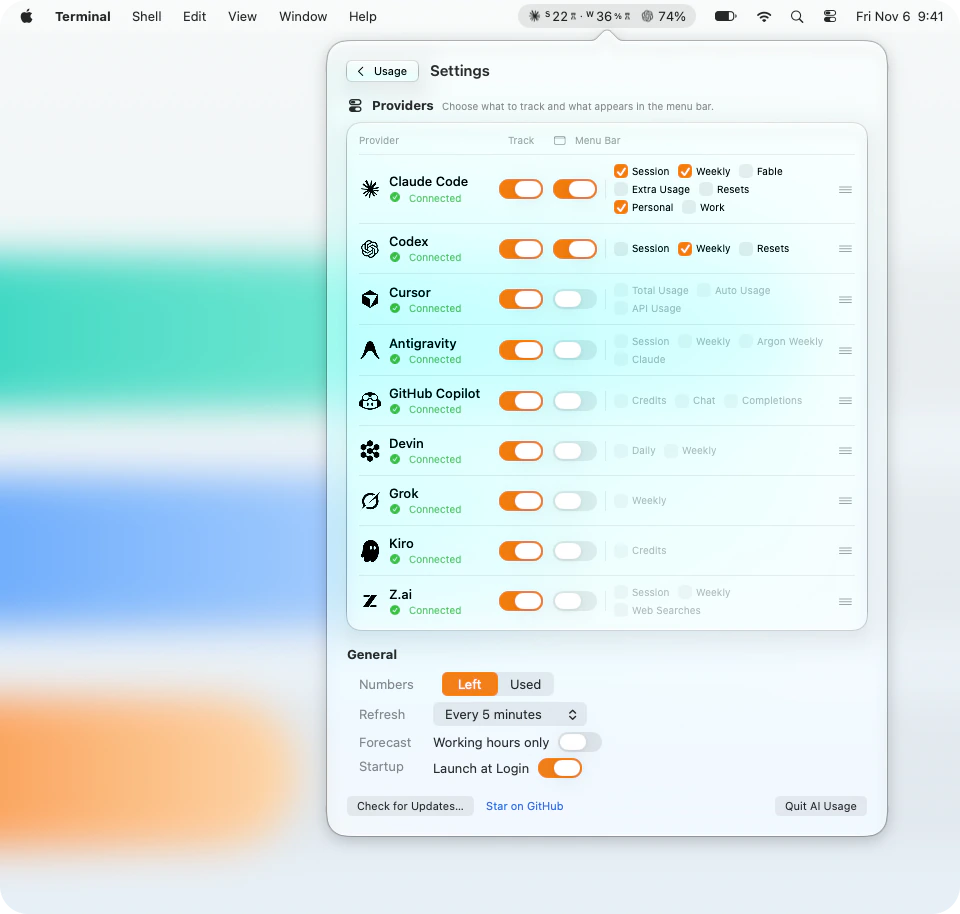

<p align="center">
  <picture>
    <source media="(prefers-color-scheme: dark)" srcset="docs/images/app-icon-dark.png">
    
  </picture>
</p>

<h1 align="center">AI Usage</h1>

<p align="center">
  <b>Every AI coding limit, right in your menu bar.</b><br>
  The mg-i-ant-mor fork of
  <a href="https://github.com/burakgon/ai-usage-menubar">burakgon/ai-usage-menubar</a>,
  with forecasts, daily budgets, and more than one Claude account.
</p>

<p align="center">
  
  <a href="LICENSE"></a>
</p>

<p align="center">
  <a href="https://github.com/mg-i-ant-mor/ai-usage-menubar/releases/latest/download/AI-Usage.dmg"></a><br>
  <sub>Signed ad-hoc: the first time, right-click the app and choose Open.</sub>
</p>

<p align="center">
  <picture>
    <source media="(prefers-color-scheme: dark)" srcset="docs/images/hero-dark.webp">
    
  </picture>
</p>

AI Usage shows what's left of every session and weekly limit of Claude Code,
Codex, Cursor, Antigravity, GitHub Copilot, Devin, Grok, Kiro, and Z.ai, when
each one resets, and how many banked resets you can still spend. It reuses the
logins your tools already have, so there is nothing to set up.

This repository is a fork of
[burakgon/ai-usage-menubar](https://github.com/burakgon/ai-usage-menubar) by
Burak Gon, released under the [MIT License](LICENSE). The app, its design, and
almost all of its code come from the original project. The fork adds the
features below and ships its own releases and update feed.

## What this fork adds

- **Forecast when a limit runs out.** When a limit is ahead of pace and will
  run out before it resets, its card shows when it will be full and an
  hourglass marks it, orange in the panel when ahead and red when far ahead.
  The tooltip also says when you'd be back on pace if you paused. Turn on
  **Working hours only** to measure weekly and monthly limits in your working
  days and hours, so nights and weekends don't skew the pace.
- **On-pace mark and daily budget.** A thin mark on each bar shows where usage
  would be now to reach the limit exactly at its reset, in the bar's color.
  Orange and red usage colors fade while you're under
  pace. Limits that last a day or more show how much you can use each day until
  they reset, as in `6.1%/day · Reset 1d 23h`.
- **More than one Claude account.** Each account is identified by its keychain
  login and gets its own card. In Settings, tick which ones the menu bar shows.
- **Detailed tooltip.** Hover the menu bar item for every limit, with limit
  icons colored by how much is used.
- **Works behind a broken proxy.** Provider requests skip the system proxy, so
  an unreachable proxy auto-config file no longer makes every provider show
  "could not be reached".

<p align="center">
  <picture>
    <source media="(prefers-color-scheme: dark)" srcset="docs/images/providers-dark.webp">
    
  </picture>
</p>

Release notes are in [docs/releases](docs/releases).

To track a second Claude account, sign it in to Claude Code with its own config
directory, named `~/.claude-<something>`:

```bash
CLAUDE_CONFIG_DIR=~/.claude-work claude
```

## Choose what the menu bar shows

<p align="center">
  <picture>
    <source media="(prefers-color-scheme: dark)" srcset="docs/images/menubar-dark.webp">
    
  </picture>
</p>

Show any tool and any limit it reports. A single limit shows just its number,
several get tiny labels, and `↻3` counts the resets you have banked. Switch
between what's left and what's used right in the panel.

<p align="center">
  <picture>
    <source media="(prefers-color-scheme: dark)" srcset="docs/images/settings-dark.webp">
    
  </picture>
</p>

Track every tool you use and choose exactly what reaches the menu bar. Usage
refreshes every 1, 5, 15, 30, or 60 minutes, and the refresh button works any
time.

<details>
<summary><b>How the menu bar decides what to show</b></summary>

- **Weekly** is selected for Claude Code and Codex at first, and **Left** is
  the default number mode.
- When a selected limit is missing, such as Claude's session window on
  accounts that have none, the tool's default limit is shown instead.
- The panel lists when each banked reset expires and turns the next one orange
  in its final 24 hours.
- When a limit is 5 weighted points or more ahead of pace (early in a window
  it takes more than 5 raw points) and on course to run out before it resets,
  its card shows when it will be full, and an hourglass marks it in the panel
  and the menu bar; in the panel it's orange when ahead and red when far ahead.
  The pace is the average since the limit's window started, weighted by how
  much of the window has passed so it counts from the first minute. It drops
  back only once the weighted lead is 5 points lower, to avoid flicker; the app
  remembers that state between refreshes while it runs and stores no usage
  history. A full limit is red, not marked with an hourglass. The tooltip
  adds when you'd be back on pace if you paused, and a stale reading keeps its
  forecast after "Not updated". Turn on **Working hours only** in Settings to
  measure weekly and monthly limits in your working days and hours, so nights
  and weekends don't skew the pace.
- A thin mark on each bar shows where usage would be now to reach the limit
  exactly at its reset. Past the mark you're ahead of pace. Sessions always measure it in clock
  time; with **Working hours only**, weekly and monthly limits measure it in
  your working time.
- Orange (from 60%) and red (from 85%) usage colors fade toward the normal
  color as you fall below pace (from 100% of pace down to 70%), and 100% is
  always red. The tooltip icons switch rather than fade.
- When Claude itself flags a limit as high usage, the card shows an
  information icon and the tooltip a "Claude: high usage" line. It's only
  shown; it never changes the risk or the colors.
- Limits that last a day or more, such as weekly and monthly ones, show how
  much you can use each day until they reset without running out, as in
  `6.1%/day · Reset 1d 23h` on the card. It's the share left divided by the days left, so it isn't
  shown in the last 24 hours before a reset or once a limit is used up.
- Percentages are shown exactly as the provider reports them. Only the bars are
  clamped to `0...100`, and a remaining percentage never goes below zero.

</details>

## Privacy

- AI Usage reads the credentials your tools already saved on this Mac. It never
  asks for a key, a password, or an account.
- Requests go only to each provider's own usage endpoint. There is no AI Usage
  server, analytics, or telemetry.
- Tokens are never printed, logged, or sent anywhere else.
- It's read-only. Resets are shown but never redeemed, and nothing in your
  accounts changes.
- Usage lives in memory and isn't kept across launches. When a refresh fails,
  the last values stay visible and are marked stale.

The exact provider contracts are documented in
[docs/provider-contracts.md](docs/provider-contracts.md).

## Install

1. Download `AI-Usage.dmg` from the
   [latest release](https://github.com/mg-i-ant-mor/ai-usage-menubar/releases/latest).
2. Open it and drag **AI Usage** to Applications.
3. The first time, right-click **AI Usage** in Applications and choose **Open**,
   then confirm. Builds are signed ad-hoc and not notarized, so a plain
   double-click is blocked by Gatekeeper the first time.

AI Usage lives in the menu bar, not the Dock. It needs macOS 26 or later and
runs natively on Apple silicon and Intel. Updates come from this fork's own
Sparkle feed, signed with the fork's key, so upstream releases never replace a
fork build. Updates installed from the panel open without the Gatekeeper prompt.

## FAQ

<details>
<summary><b>Which plans work?</b></summary>

Whatever plan you're on. AI Usage shows the limits each provider reports for
your account and names the plan when the provider does.

</details>

<details>
<summary><b>Codex shows no usage.</b></summary>

Sign in to Codex with ChatGPT. API-key-only authentication can't read ChatGPT
subscription usage.

</details>

<details>
<summary><b>Why isn't <code>CLAUDE_CODE_OAUTH_TOKEN</code> used?</b></summary>

Setup tokens don't include the profile scope Claude's usage endpoint requires.
Sign in to Claude Code normally and AI Usage picks up that login.

</details>

<details>
<summary><b>Cursor says its editor login is encrypted.</b></summary>

Cursor 3.27 and later encrypt the editor's saved login with a key only Cursor
can read, and AI Usage doesn't open another app's private storage. It reads the
Cursor CLI's login instead: install the
[Cursor CLI](https://cursor.com/docs/cli/installation) and run `agent login`
once.

</details>

<details>
<summary><b>Antigravity shows no quota.</b></summary>

Google doesn't share the quota of some accounts. Open Antigravity or run `agy`,
and AI Usage reads the quota from it instead.

</details>

<details>
<summary><b>Can I redeem a reset from AI Usage?</b></summary>

No. Resets are shown read-only. Redeem them in the provider's own app.

</details>

## Build from source

You need macOS 26 or later and Xcode 27 or later.

```bash
git clone https://github.com/mg-i-ant-mor/ai-usage-menubar.git
cd ai-usage-menubar
./scripts/install.sh
```

The script builds a Release version, installs it to
`~/Applications/AI Usage.app`, and opens it. To work on the app, open
`AIUsage.xcodeproj` and run the `AIUsage` scheme.

Run the tests with:

```bash
xcodebuild test \
  -project AIUsage.xcodeproj \
  -scheme AIUsage \
  -destination 'platform=macOS'
```

The app is SwiftUI and AppKit, with a small provider layer and an in-memory
store. Its only dependency is [Sparkle](https://github.com/sparkle-project/Sparkle),
for signed updates.

- `./scripts/render_readme_images.sh` renders the README images from the real
  views with made-up data.
- `./scripts/generate_app_icon.swift` regenerates the icon previews.


## Releasing

Versions, packaging, the Sparkle key, and the appcast are described in
[docs/releasing.md](docs/releasing.md).

## Contributing

Pull requests go to `develop`; `main` only receives `develop` during a release.
Please read [CONTRIBUTING.md](CONTRIBUTING.md) first, and report security issues
privately as described in [SECURITY.md](SECURITY.md). Fixes that aren't
specific to this fork are better sent to the
[original project](https://github.com/burakgon/ai-usage-menubar).

## Credits

AI Usage was created by Burak Gon at
[burakgon/ai-usage-menubar](https://github.com/burakgon/ai-usage-menubar).
This fork is maintained by mg-i-ant-mor.

Provider contracts and parts of the system-boundary implementation were adapted
from [OpenUsage](https://github.com/robinebers/openusage), using stable tag
`v0.7.6`, local language-server discovery from tag `v0.7.16`, provider
updates through commit `fdf7a234b76b6a71522880cc9ab5b38044471698`, and the
Antigravity quota host order and client identity from commits `ee98159` and
`e1ffa57`. See [NOTICE](NOTICE) for attribution. Provider names and marks
belong to their owners and don't imply endorsement.

## License

AI Usage is available under the [MIT License](LICENSE), which keeps the
original copyright notice.
